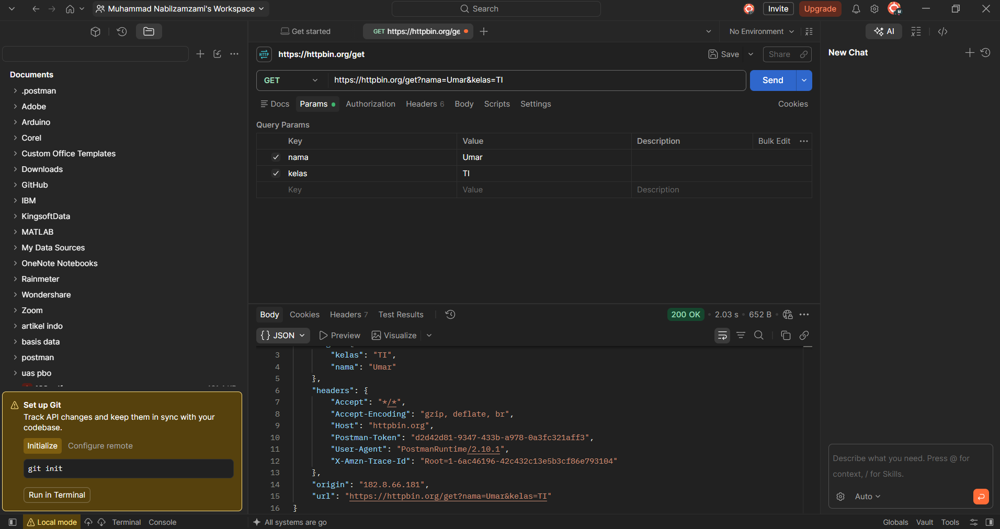
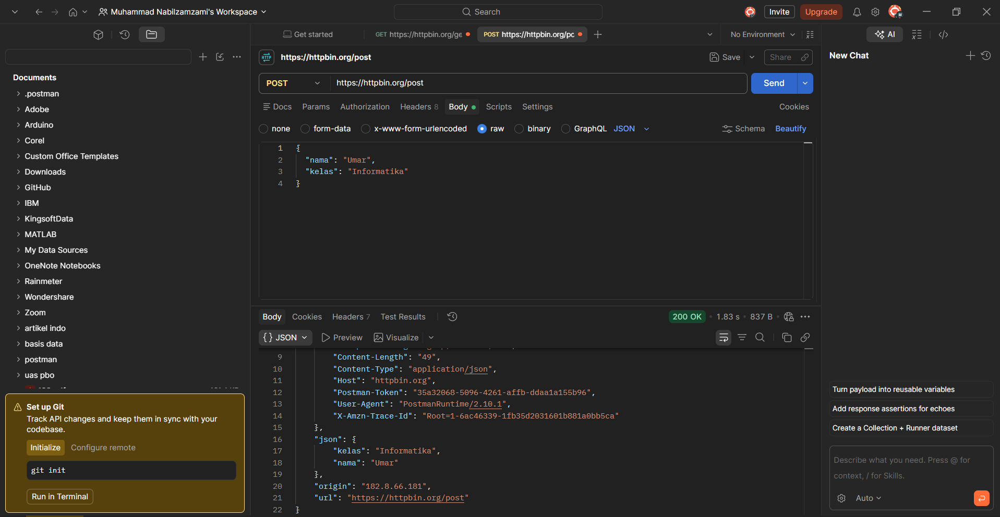
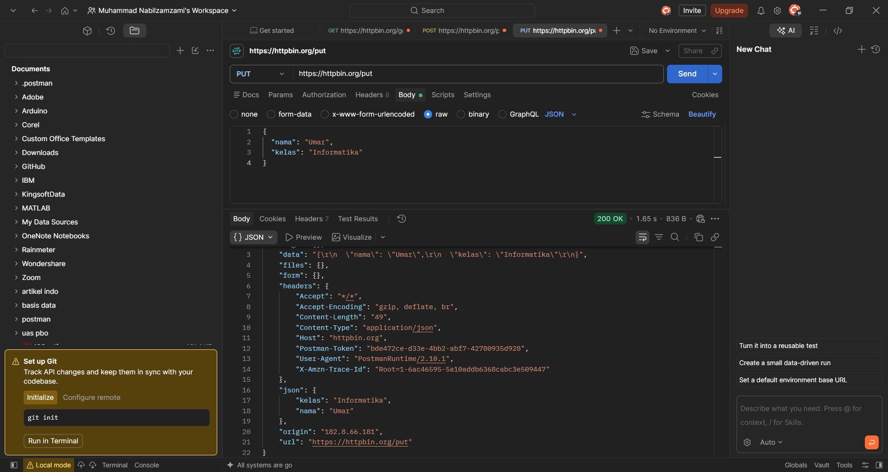
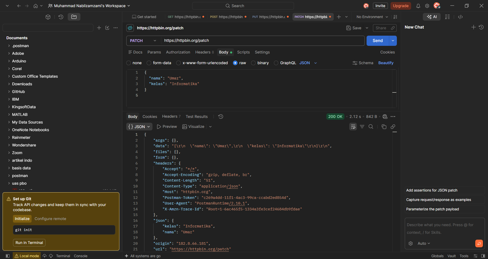
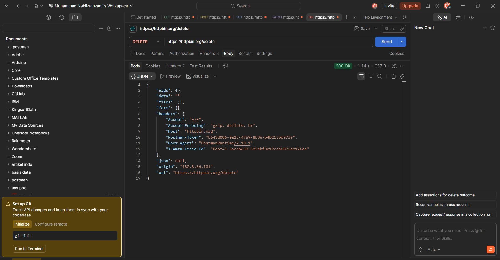

# Tugas Mandiri 1 — Mengenal HTTP Method dan Endpoint

## 1. Judul dan Tujuan

Tugas ini bertujuan untuk melihat langsung bagaimana HTTP method, endpoint, parameter, request, dan response saling berhubungan. Pengujian memakai layanan publik HTTPBin (`https://httpbin.org`) dan dilakukan lewat Postman terhadap lima endpoint: `/get`, `/post`, `/put`, `/patch`, dan `/delete`.

## 2. Cara Menjalankan

1. Buka Postman, lalu buat satu request baru untuk setiap endpoint.
2. Pilih method sesuai endpoint dan isi URL lengkapnya, misalnya `https://httpbin.org/get`.
3. Untuk GET, tambahkan dua query parameter di tab Params: `nama=Umar` dan `kelas=TI`.
4. Untuk POST, PUT, dan PATCH, buka tab Body, pilih `raw` dengan tipe `JSON`, lalu isi:

   ```json
   {
     "nama": "Umar",
     "kelas": "Informatika"
   }
   ```

5. Untuk DELETE, request dikirim tanpa body.
6. Klik Send, lalu catat status code dan isi response. Setiap hasil di-screenshot (lihat Bagian 4).

## 3. Hasil Pengujian

| No | Method | Endpoint | Data yang dikirim | Status | Hasil |
|---:|---|---|---|---:|---|
| 1 | GET | `/get` | Query parameter `nama=Umar&kelas=TI` | 200 OK | Query parameter muncul kembali di field `args` |
| 2 | POST | `/post` | Body JSON `nama` dan `kelas` | 200 OK | Body JSON terbaca di field `json` |
| 3 | PUT | `/put` | Body JSON `nama` dan `kelas` | 200 OK | Body JSON terbaca di field `json` |
| 4 | PATCH | `/patch` | Body JSON `nama` dan `kelas` | 200 OK | Body JSON terbaca di field `json` |
| 5 | DELETE | `/delete` | Tidak ada | 200 OK | Tidak ada body, `data` kosong dan `json` bernilai `null` |

Pada potongan response di bawah, saya hanya menampilkan field yang penting. Field `origin` dan header acak seperti `Postman-Token` dan `X-Amzn-Trace-Id` tidak saya tulis ulang, tetapi response lengkapnya terlihat di screenshot.

### 3.1. GET /get

- **URL lengkap:** `https://httpbin.org/get?nama=Umar&kelas=TI`
- **Tujuan:** menguji request GET yang membawa data lewat query parameter.
- **Data yang dikirim:** `nama=Umar` dan `kelas=TI` di URL.
- **Status:** 200 OK

```json
{
  "args": {
    "kelas": "TI",
    "nama": "Umar"
  },
  "headers": {
    "Accept": "*/*",
    "Host": "httpbin.org",
    "User-Agent": "PostmanRuntime/2.10.1"
  },
  "url": "https://httpbin.org/get?nama=Umar&kelas=TI"
}
```

Server mengembalikan lagi apa yang diterimanya: query parameter di `args`, header request di `headers`, dan URL lengkap di `url`.

### 3.2. POST /post

- **URL lengkap:** `https://httpbin.org/post`
- **Tujuan:** menguji request POST yang mengirim data lewat request body.
- **Data yang dikirim:** JSON `{"nama": "Umar", "kelas": "Informatika"}` di body.
- **Status:** 200 OK

```json
{
  "args": {},
  "headers": {
    "Content-Length": "49",
    "Content-Type": "application/json",
    "Host": "httpbin.org"
  },
  "json": {
    "kelas": "Informatika",
    "nama": "Umar"
  },
  "url": "https://httpbin.org/post"
}
```

Field `args` kosong karena data tidak dikirim lewat URL. Data saya sekarang ada di `json`, dan header `Content-Type: application/json` ikut terkirim karena request ini punya body.

### 3.3. PUT /put

- **URL lengkap:** `https://httpbin.org/put`
- **Tujuan:** menguji request PUT dengan body JSON.
- **Data yang dikirim:** JSON yang sama seperti pada POST.
- **Status:** 200 OK

```json
{
  "args": {},
  "headers": {
    "Content-Length": "49",
    "Content-Type": "application/json",
    "Host": "httpbin.org"
  },
  "json": {
    "kelas": "Informatika",
    "nama": "Umar"
  },
  "url": "https://httpbin.org/put"
}
```

Bentuk response sama dengan POST, hanya `url` yang berbeda. HTTPBin hanya mencerminkan request, jadi tidak ada data yang benar-benar diganti di server.

### 3.4. PATCH /patch

- **URL lengkap:** `https://httpbin.org/patch`
- **Tujuan:** menguji request PATCH dengan body JSON.
- **Data yang dikirim:** JSON yang sama seperti pada POST.
- **Status:** 200 OK

```json
{
  "args": {},
  "headers": {
    "Content-Length": "51",
    "Content-Type": "application/json",
    "Host": "httpbin.org"
  },
  "json": {
    "kelas": "Informatika",
    "nama": "Umar"
  },
  "url": "https://httpbin.org/patch"
}
```

`Content-Length` di sini 51, bukan 49 seperti POST dan PUT. Penyebabnya ada baris kosong tambahan di akhir body yang saya ketik di Postman. Isi JSON-nya sendiri tetap sama.

### 3.5. DELETE /delete

- **URL lengkap:** `https://httpbin.org/delete`
- **Tujuan:** menguji request DELETE.
- **Data yang dikirim:** tidak ada.
- **Status:** 200 OK

```json
{
  "args": {},
  "data": "",
  "headers": {
    "Accept": "*/*",
    "Host": "httpbin.org",
    "User-Agent": "PostmanRuntime/2.10.1"
  },
  "json": null,
  "url": "https://httpbin.org/delete"
}
```

Karena tidak ada body, header `Content-Type` dan `Content-Length` tidak muncul, `data` kosong, dan `json` bernilai `null`.

## 4. Bukti Visual



*Gambar 1. GET `https://httpbin.org/get?nama=Umar&kelas=TI` di Postman, status 200 OK.*



*Gambar 2. POST `https://httpbin.org/post` dengan body JSON, status 200 OK.*



*Gambar 3. PUT `https://httpbin.org/put` dengan body JSON, status 200 OK.*



*Gambar 4. PATCH `https://httpbin.org/patch` dengan body JSON, status 200 OK.*



*Gambar 5. DELETE `https://httpbin.org/delete` tanpa body, status 200 OK.*

## 5. Kesimpulan

Kelima method menghasilkan status 200 karena HTTPBin memang dibuat untuk mengembalikan isi request apa adanya. Dari hasilnya terlihat bahwa GET membawa data lewat URL (`args`), sedangkan POST, PUT, dan PATCH membawa data lewat body (`json`), dan DELETE tidak membawa data sama sekali. Di API latihan Express pada modul, status yang dikembalikan lebih beragam, misalnya POST yang berhasil memberi 201 Created.

## 6. Lampiran

- Pull Request: _(isi tautan PR setelah dibuat)_
- Reviewer: _(isi nama rekan yang mereview)_
- Issue terkait: Tidak ada
