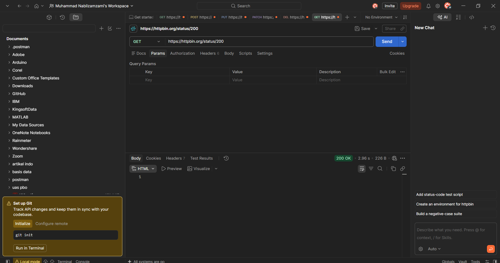
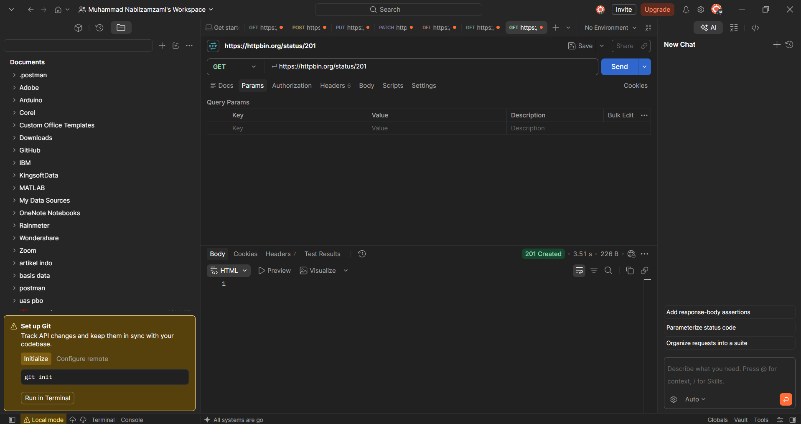
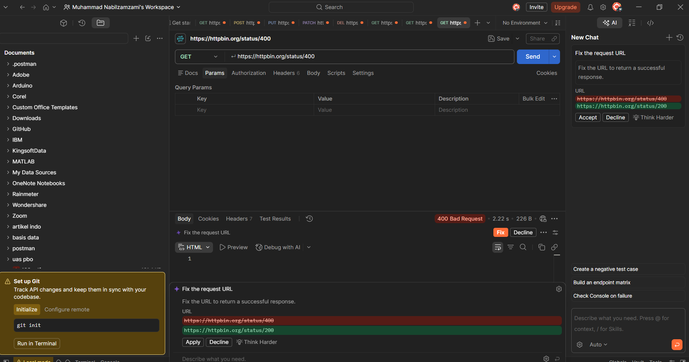
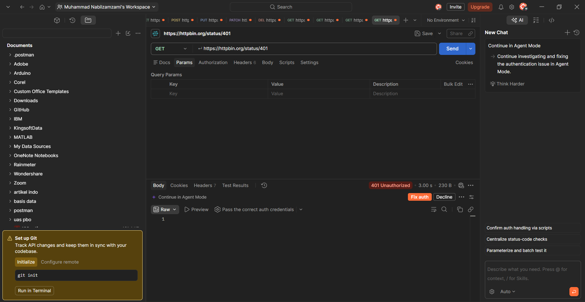
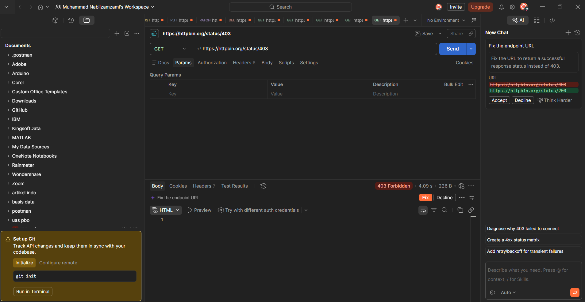
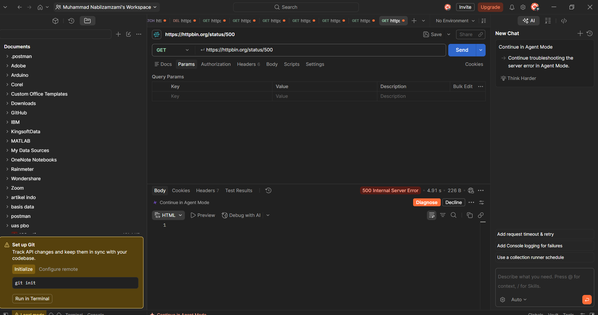

# Tugas Mandiri 2 — Memahami HTTP Status Code

## 1. Judul dan Tujuan

Tugas ini bertujuan untuk mengenali arti beberapa HTTP status code dengan cara memintanya langsung ke server. HTTPBin menyediakan endpoint `/status/:code` yang mengembalikan status sesuai angka yang saya tulis di URL, jadi semua kode bisa dicoba tanpa membuat backend sendiri.

## 2. Cara Menjalankan

1. Buka Postman dan buat request baru dengan method GET.
2. Isi URL `https://httpbin.org/status/200`, lalu klik Send.
3. Catat status yang tampil di Postman, lalu ambil screenshot.
4. Ulangi untuk kode 201, 400, 401, 403, 404, dan 500 dengan mengganti angka di akhir URL.

Endpoint yang diuji:

- `GET https://httpbin.org/status/200`
- `GET https://httpbin.org/status/201`
- `GET https://httpbin.org/status/400`
- `GET https://httpbin.org/status/401`
- `GET https://httpbin.org/status/403`
- `GET https://httpbin.org/status/404`
- `GET https://httpbin.org/status/500`

## 3. Hasil Pengujian

### 3.1. Tabel Status Code

| Status Code | Arti | Hasil Pengujian | Kapan Digunakan |
|---:|---|---|---|
| 200 | OK | Postman menampilkan `200 OK`, body kosong | Request berhasil diproses, misalnya saat mengambil, mengubah, atau menghapus data |
| 201 | Created | Postman menampilkan `201 Created`, body kosong | Data baru berhasil dibuat, biasanya setelah POST |
| 400 | Bad Request | Postman menampilkan `400 Bad Request`, body kosong | Request dari client tidak bisa diproses karena isinya salah atau tidak lengkap |
| 401 | Unauthorized | Postman menampilkan `401 Unauthorized`, body kosong | Client belum login atau kredensialnya tidak valid |
| 403 | Forbidden | Postman menampilkan `403 Forbidden`, body kosong | Client sudah dikenali, tetapi tidak punya izin untuk mengakses resource |
| 404 | Not Found | Postman menampilkan `404 Not Found`, body kosong | URL atau data yang diminta tidak ada |
| 500 | Internal Server Error | Postman menampilkan `500 Internal Server Error`, body kosong | Server gagal memproses request karena error di sisi server |

### 3.2. Jawaban Pertanyaan

**1. Apa perbedaan 400 dan 404?**

Status 400 berarti server menerima request, tetapi isinya bermasalah sehingga tidak bisa diproses, misalnya field wajib tidak diisi. Status 404 berarti request-nya sendiri bisa dibaca, tetapi alamat atau data yang dicari tidak ada di server, misalnya `/jadwal/99` padahal data dengan id 99 tidak ada.

**2. Apa perbedaan 401 dan 403?**

Status 401 dipakai saat server belum tahu siapa kita, misalnya belum login atau tokennya salah. Status 403 dipakai saat server sudah tahu siapa kita, tetapi akun tersebut tidak diizinkan mengakses resource yang diminta, misalnya pengguna biasa membuka halaman admin.

**3. Mengapa 500 menunjukkan masalah pada sisi server?**

Pada status 500, request dari client sebenarnya sudah diterima, tetapi server gagal memprosesnya karena ada error di dalam server, misalnya bug di kode atau koneksi database yang putus. Client tidak bisa memperbaikinya dengan mengubah request, jadi yang perlu memeriksa adalah tim backend lewat log server.

**4. Apakah semua error HTTP berarti server mengalami kerusakan?**

Tidak. Status 4xx seperti 400, 401, 403, dan 404 menandakan ada yang perlu diperbaiki dari sisi request, entah isinya, login-nya, izinnya, atau alamatnya. Hanya status 5xx yang menandakan masalah di server, dan itu pun belum tentu servernya "rusak", bisa saja hanya ada satu bagian kode yang error.

## 4. Bukti Visual

*Gambar 1. GET `https://httpbin.org/status/200`, Postman menampilkan 200 OK.*

*Gambar 2. GET `https://httpbin.org/status/201`, Postman menampilkan 201 Created.*

*Gambar 3. GET `https://httpbin.org/status/400`, Postman menampilkan 400 Bad Request.*

*Gambar 4. GET `https://httpbin.org/status/401`, Postman menampilkan 401 Unauthorized.*

*Gambar 5. GET `https://httpbin.org/status/403`, Postman menampilkan 403 Forbidden.*

*Gambar 6. GET `https://httpbin.org/status/404`, Postman menampilkan 404 Not Found.*

*Gambar 7. GET `https://httpbin.org/status/500`, Postman menampilkan 500 Internal Server Error.*

## 5. Kesimpulan

Dari ketujuh pengujian, setiap status code punya arti yang berbeda dan bisa dikelompokkan menurut angka depannya: 2xx untuk request yang berhasil, 4xx untuk kesalahan dari sisi client, dan 5xx untuk kesalahan dari sisi server. Memahami pengelompokan ini membantu saya menentukan harus mulai memeriksa dari mana saat sebuah request gagal: request-nya dulu, atau server-nya.

## 6. Lampiran

- Pull Request: _(isi tautan PR setelah dibuat)_
- Reviewer: _(isi nama rekan yang mereview)_
- Issue terkait: Tidak ada
