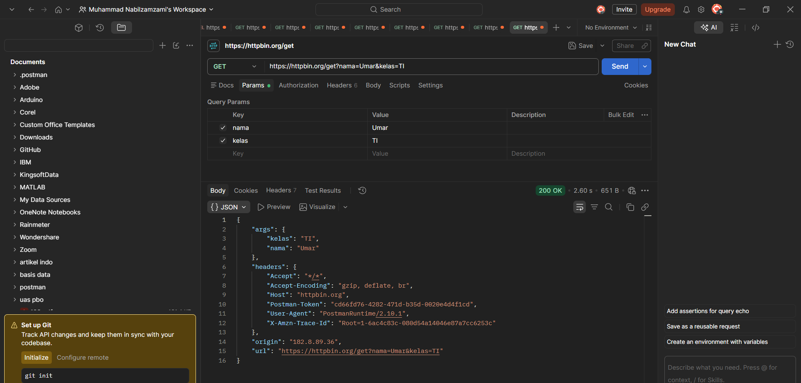
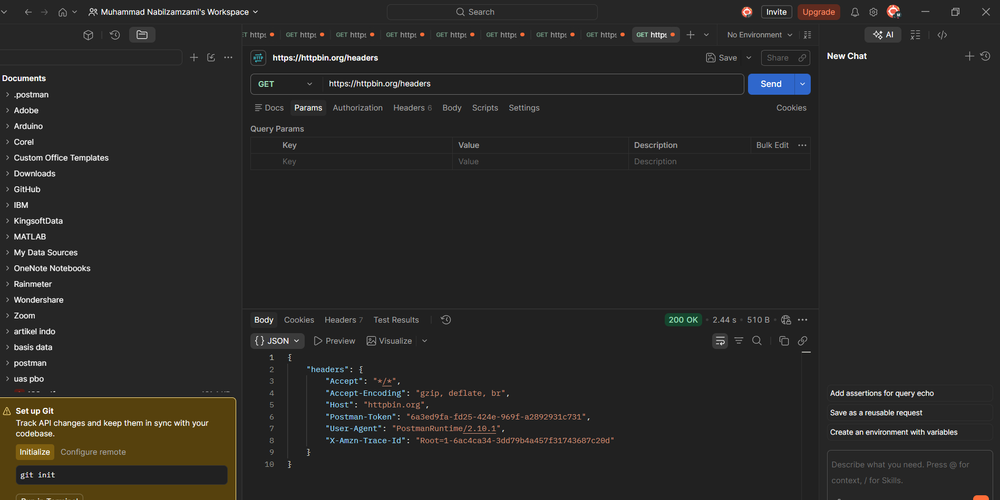

# Tugas Mandiri 3 — Memahami Request dan Response

## 1. Judul dan Tujuan

Tugas ini bertujuan untuk melihat informasi apa saja yang benar-benar dikirim client ke server dan apa yang dikembalikan server. Endpoint `/get` dan `/headers` dari HTTPBin cocok untuk ini karena keduanya menampilkan kembali request yang mereka terima.

## 2. Cara Menjalankan

1. Di Postman, buat request GET ke `https://httpbin.org/get`.
2. Tambahkan query parameter `nama=Umar` dan `kelas=TI` di tab Params, sehingga URL menjadi `https://httpbin.org/get?nama=Umar&kelas=TI`. Klik Send dan perhatikan response-nya.
3. Buat request GET baru ke `https://httpbin.org/headers`, klik Send, lalu perhatikan header yang diterima server.
4. Ambil screenshot kedua response.

## 3. Hasil Pengujian

### 3.1. GET /get dengan query parameter

- **URL:** `https://httpbin.org/get?nama=Umar&kelas=TI`
- **Method:** GET
- **Status:** 200 OK

```json
{
  "args": {
    "kelas": "TI",
    "nama": "Umar"
  },
  "headers": {
    "Accept": "*/*",
    "Accept-Encoding": "gzip, deflate, br",
    "Host": "httpbin.org",
    "User-Agent": "PostmanRuntime/2.10.1"
  },
  "url": "https://httpbin.org/get?nama=Umar&kelas=TI"
}
```

Response ini memperlihatkan tiga hal. Query parameter yang saya kirim terbaca di `args`. Header yang dibawa request tercatat di `headers`. Alamat lengkap yang diminta tercatat di `url`. (Field `origin`, `Postman-Token`, dan `X-Amzn-Trace-Id` tidak saya tulis ulang di sini, tetapi terlihat di screenshot.)

### 3.2. GET /headers

- **URL:** `https://httpbin.org/headers`
- **Method:** GET
- **Status:** 200 OK

```json
{
  "headers": {
    "Accept": "*/*",
    "Accept-Encoding": "gzip, deflate, br",
    "Host": "httpbin.org",
    "User-Agent": "PostmanRuntime/2.10.1"
  }
}
```

Endpoint ini hanya mengembalikan header. Dari sini terlihat bahwa Postman menambahkan beberapa header sendiri tanpa saya atur, antara lain `User-Agent`, `Accept`, dan `Accept-Encoding`. Header `X-Amzn-Trace-Id` juga ada, tetapi bukan saya yang menambahkannya. Kemungkinan header itu dipasang oleh infrastruktur di sisi HTTPBin.

### 3.3. Alur request dan response

Alur dari kedua pengujian di atas bisa digambarkan seperti ini:

```
Request   : GET /get?nama=Umar&kelas=TI  (dikirim Postman beserta header)
    ↓
Server    : httpbin.org membaca method, URL, query, dan header
    ↓
Response  : status 200 OK + JSON yang berisi args, headers, dan url
```

### 3.4. Jawaban Pertanyaan

**1. Apa yang dimaksud request?**

Request adalah permintaan yang dikirim client ke server. Isinya terdiri dari method (misalnya GET), URL, header, dan kadang body. Pada tugas ini, request-nya adalah `GET /get?nama=Umar&kelas=TI` dari Postman.

**2. Apa yang dimaksud response?**

Response adalah jawaban dari server atas request tadi. Isinya status code, header, dan body. Pada pengujian ini, server menjawab dengan status 200 OK dan body JSON.

**3. Apa fungsi query parameter?**

Query parameter dipakai untuk menyisipkan data tambahan di URL, tepatnya setelah tanda `?` dengan format `kunci=nilai` dan dipisahkan `&`. Biasanya dipakai untuk filter atau pencarian. Pada contoh ini, `nama=Umar` dan `kelas=TI` dikirim ke server dan muncul lagi di field `args`.

**4. Apa fungsi HTTP header?**

Header membawa informasi tentang request atau response yang bukan bagian dari datanya sendiri. Contohnya `User-Agent` yang menyebut aplikasi pengirim, `Accept` yang menyebut format balasan yang diterima, dan `Content-Type` yang menyebut format body. Header juga dipakai untuk mengirim token autentikasi.

**5. Apa perbedaan data pada URL dengan data pada request body?**

Data di URL (query parameter) ikut menjadi bagian alamat, jadi terlihat jelas, tersimpan di riwayat browser atau log, dan cocok untuk filter atau pencarian. Data di request body dikirim terpisah dari alamat, biasanya berupa JSON pada POST, PUT, atau PATCH, dan lebih sesuai untuk data yang banyak atau yang tidak boleh terlihat di URL seperti password.

## 4. Bukti Visual



*Gambar 1. GET `https://httpbin.org/get?nama=Umar&kelas=TI`, `args` berisi `nama` dan `kelas`.*



*Gambar 2. GET `https://httpbin.org/headers`, response berisi header yang diterima server.*

## 5. Kesimpulan

Lewat `/get` dan `/headers` saya bisa melihat bahwa sebuah request tidak hanya berisi URL, tetapi juga header dan bisa juga query parameter atau body, dan semuanya diterima server lalu dijawab dengan response berisi status, header, dan body. Query parameter cocok untuk data ringan seperti filter, sedangkan data yang lebih besar atau sensitif lebih tepat dikirim lewat body.

## 6. Lampiran

- Pull Request: _(isi tautan PR setelah dibuat)_
- Reviewer: _(isi nama rekan yang mereview)_
- Issue terkait: Tidak ada
