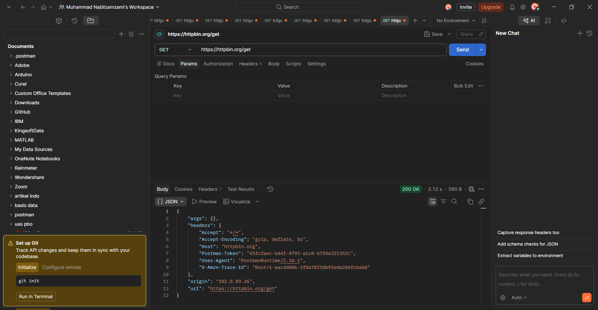
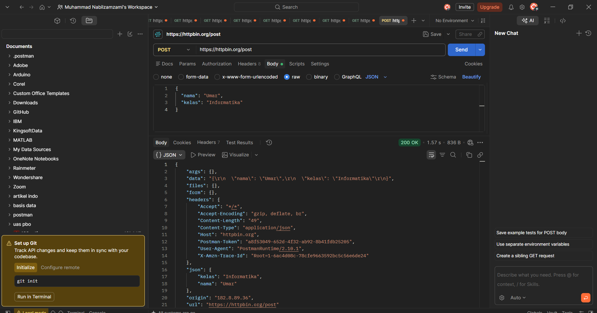
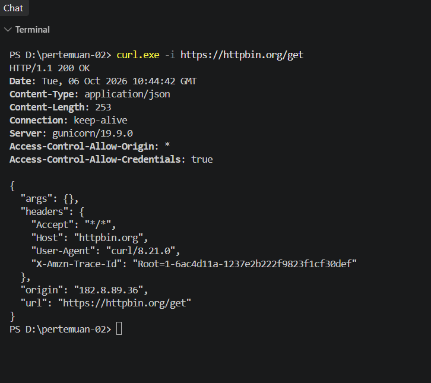
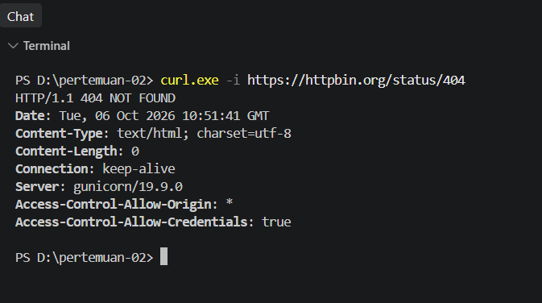
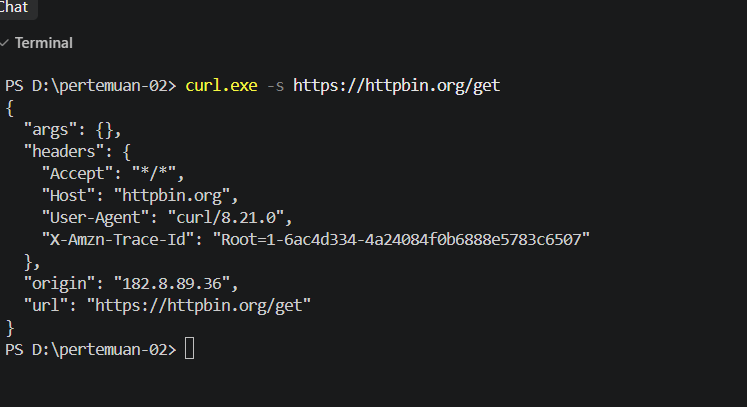

# Tugas Mandiri 4 — Pengujian API dengan Postman dan curl

## 1. Judul dan Tujuan

Tugas ini bertujuan untuk menguji API yang sama dengan dua alat, yaitu Postman yang berbasis tampilan dan curl yang berbasis terminal, lalu membandingkan hasil yang didapat. Endpoint yang dipakai tetap dari HTTPBin.

## 2. Cara Menjalankan

**Postman**

1. Buat request GET ke `https://httpbin.org/get`, klik Send.
2. Buat request POST ke `https://httpbin.org/post`. Di tab Body pilih `raw` dengan tipe `JSON`, lalu isi:

   ```json
   {
     "nama": "Umar",
     "kelas": "Informatika"
   }
   ```

3. Klik Send, lalu bandingkan response POST dengan response GET.

**curl**

Perintah dijalankan di PowerShell. Di PowerShell, `curl` adalah alias dari `Invoke-WebRequest`, jadi saya memakai `curl.exe` supaya yang berjalan benar-benar curl.

```bash
curl.exe -i https://httpbin.org/get
curl.exe -i https://httpbin.org/status/404
curl.exe -s https://httpbin.org/get
```

## 3. Hasil Pengujian

### 3.1. Postman

**GET `https://httpbin.org/get`** menghasilkan 200 OK. Response hanya berisi `args` (kosong), `headers`, `origin`, dan `url`.

**POST `https://httpbin.org/post`** juga menghasilkan 200 OK, tetapi isinya lebih banyak:

```json
{
  "args": {},
  "data": "{\r\n  \"nama\": \"Umar\",\r\n  \"kelas\": \"Informatika\"\r\n}",
  "files": {},
  "form": {},
  "headers": {
    "Content-Length": "49",
    "Content-Type": "application/json",
    "Host": "httpbin.org"
  },
  "json": {
    "kelas": "Informatika",
    "nama": "Umar"
  },
  "url": "https://httpbin.org/post"
}
```

Perbandingan keduanya:

| Aspek | GET `/get` | POST `/post` |
|---|---|---|
| Status | 200 OK | 200 OK |
| Data yang dikirim | Tidak ada | Body JSON `nama` dan `kelas` |
| Field `data` dan `json` | Tidak ada | Ada, berisi body yang dikirim |
| Header `Content-Type` dan `Content-Length` | Tidak ada | `application/json` dan `49` |
| Ukuran response | 590 B | 836 B |

Selisih ukuran itu wajar, karena response POST menyertakan body yang saya kirim, dua kali (sebagai teks mentah di `data` dan sebagai objek di `json`).

### 3.2. curl

**`curl.exe -i https://httpbin.org/get`** menampilkan status line dan header lebih dulu, baru body:

```
HTTP/1.1 200 OK
Content-Type: application/json
Content-Length: 253
Connection: keep-alive
Server: gunicorn/19.9.0
Access-Control-Allow-Origin: *
Access-Control-Allow-Credentials: true
```

Bodynya berisi `args` kosong, `headers` (dengan `User-Agent: curl/8.21.0`), `origin`, dan `url`. Header `Date` dan `origin` tidak saya tulis di sini, tetapi terlihat di screenshot.

**`curl.exe -i https://httpbin.org/status/404`** menampilkan:

```
HTTP/1.1 404 NOT FOUND
Content-Type: text/html; charset=utf-8
Content-Length: 0
Connection: keep-alive
Server: gunicorn/19.9.0
```

Status 404 terbaca di baris pertama, dan body-nya kosong (`Content-Length: 0`).

Dibandingkan dengan Postman, request dari curl membawa header lebih sedikit. Tidak ada `Postman-Token` maupun `Accept-Encoding`, dan `User-Agent`-nya `curl/8.21.0`, bukan `PostmanRuntime`.

### 3.3. Perbandingan `curl -s` dan `curl -i`

Perbedaan paling jelas ada di keluarannya. `curl -i` menampilkan status line dan header respons (seperti `HTTP/1.1 200 OK`, `Content-Type`, dan `Content-Length`) sebelum body, sedangkan `curl -s` hanya menampilkan body JSON. Opsi `-s` (silent) mematikan progress meter dan pesan error dari curl, sehingga keluarannya bersih dan enak dipakai kalau hasilnya mau diteruskan ke tool lain atau dipakai di script. Opsi `-i` (include) menyertakan header respons, jadi status code dan tipe konten bisa langsung terlihat. Saya memakai `-i` saat menguji atau mencari penyebab error, dan `-s` saat hanya butuh isi datanya.

## 4. Bukti Visual



*Gambar 1. GET `https://httpbin.org/get` di Postman, status 200 OK.*



*Gambar 2. POST `https://httpbin.org/post` di Postman dengan body JSON, status 200 OK.*



*Gambar 3. `curl.exe -i https://httpbin.org/get` di PowerShell, header dan body tampil bersama.*



*Gambar 4. `curl.exe -i https://httpbin.org/status/404`, status 404 NOT FOUND tampil di baris pertama.*



*Gambar 5. `curl.exe -s https://httpbin.org/get`, hanya body JSON yang tampil.*

## 5. Kesimpulan

Postman praktis untuk mengatur body, header, dan melihat response dalam tampilan yang rapi, sedangkan curl lebih cepat dipakai dari terminal dan memperlihatkan header respons lewat `-i`. Perbandingan GET dan POST juga menunjukkan bahwa POST membawa body dan header `Content-Type`, sementara GET tidak. Untuk pengujian berikutnya, saya akan memakai Postman saat perlu mengirim body yang rumit dan curl saat ingin mengecek status dan header dengan cepat.

## 6. Lampiran

- Pull Request: _(isi tautan PR setelah dibuat)_
- Reviewer: _(isi nama rekan yang mereview)_
- Issue terkait: Tidak ada
